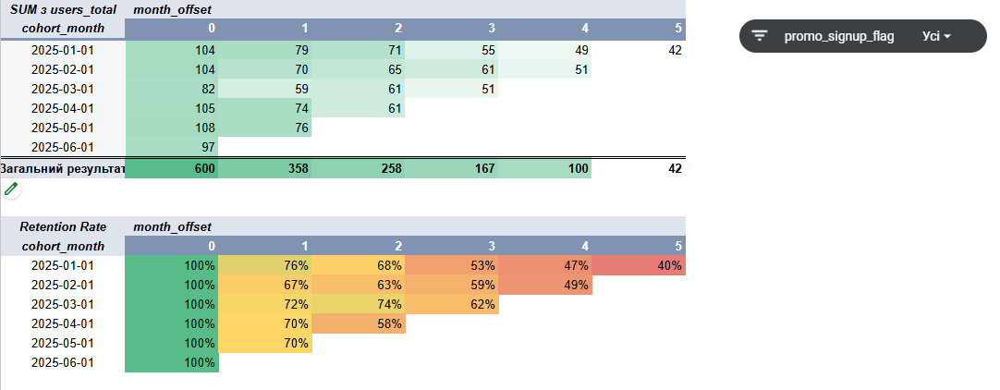
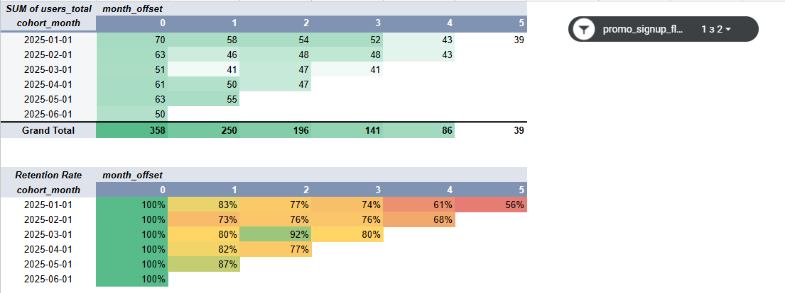
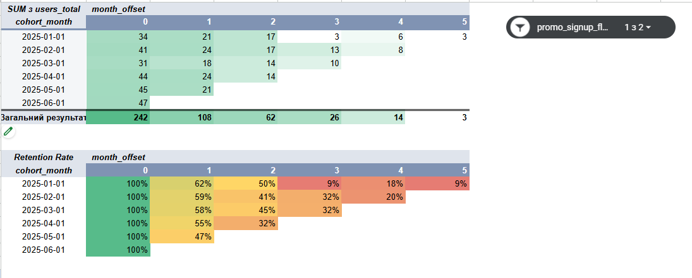

# User Retention Rate & Cohort Analysis

**SQL · Google Sheets · DBeaver · PostgreSQL**

Cohort analysis of user retention: raw data is cleaned and cohorts are built in SQL, then interactive cohort tables in Google Sheets compare **promo** and **organic** users to assess acquisition quality.

> Training project (course dataset).

---

## 🎯 Goal

Show how user retention changes over the first months after signup and answer a practical business question: **do promo campaigns bring users who stay?**

- How does Retention Rate change across monthly signup cohorts?
- How do promo users (acquired through promotions and ads) behave compared with organic users?
- What does this say about acquisition quality, and what should the business change?

---

## 🗂 Data

Two raw tables:

| Table | Content |
|---|---|
| `cohort_users_raw` | `user_id`, signup date/time (free-form text), signup source, device, `promo_signup_flag` (1 = promo, 0 = organic) |
| `cohort_events_raw` | `event_id`, `user_id`, event date/time (free-form text), `event_type`, revenue |

**Data quality issues solved in SQL**
- Dates stored as text with mixed separators (`.` `/` `-`), 2- and 4-digit years, 1- and 2-digit days and months
- Test events (`test_event`), empty event types, NULL values
- Events outside the observation window (Jan–Jun 2025)

---

## 🔧 Approach

### 1. SQL: data preparation (DBeaver, PostgreSQL)
1. Explored both tables, checked for empty dates and unusual event types
2. Normalized text dates with `regexp_replace` + `CASE` + `to_date` (separate handling for `YYYY` and `YY`), and checked that no NULLs remained after conversion
3. Removed test and empty events (4,104 → 4,056 valid rows)
4. Joined users and events, assigned each user to a **signup-month cohort**
5. Calculated the **month offset** (months between signup and activity)
6. Aggregated unique active users by promo flag, cohort month and month offset, within the observation window

Final query: [`sql/Cohort_analysis_FP_1_Khomenko_final.sql`](sql/Cohort_analysis_FP_1_Khomenko_final.sql)

### 2. Google Sheets: cohort tables
- Loaded the SQL output into Google Sheets
- Built cohort tables with pivot tables (cohort month × month offset)
- Calculated Retention Rate as active users in month N ÷ cohort size in month 0, using formulas with mixed absolute and relative references (`$B3`)
- Compared promo and organic users and formulated conclusions and recommendations

---

## 📈 Results

### Key findings

- **Promo campaigns did not deliver the expected result.** Organic acquisition is higher quality and better for long-term retention: organic cohorts keep **over 50%** of users even in month 5, while promo cohorts drop **below 10%**.
- **Acquisition volume.** Organic is the main source of users: **358** users in month 0 vs. **242** from promo.
- **Churn point.** Both channels lose the most users in month 1, but promo much more sharply: only **47–62%** of promo users remain vs. **73–87%** of organic users.
- **Retention.** Promo users arrive but do not return: retention falls to **9%** by month 5. Organic traffic stays stable at **56%** in month 5.

### Recommendations

1. **Change how promo campaigns are evaluated.** Judge them by active users after 3–4 months, not by initial traffic. Measured at launch they look successful; by month 5 their long-term value is minimal.
2. **Audit promo traffic sources.** Analyze which platforms, banners or partnerships bring promo users, find where the gap between ad expectations and the real product experience appears, and compare promo and organic user journeys.
3. **Invest in early retention.** Focus on the first 30 days: promo cohorts lose about half of their audience between month 0 and month 1.
4. **Scale organic channels.** Shift part of the promo budget toward product improvement and referral mechanics ("invite a friend", sharing, content sharing by current users) to bring in loyal users who find the product themselves and stay longer.

🔗 [Google Sheets cohort model](https://docs.google.com/spreadsheets/d/1YE_AwK6lvfs4sGcmUpeZucy5gmYDZcSgJPxOoxCoc64/edit?usp=drive_link)

---

## 🖼 Screenshots

**All users**


**Organic users**


**Promo users**


---

## 🛠 Skills demonstrated

| Area | Skills |
|---|---|
| **SQL** | CTEs, joins, filtering, regex-based date parsing, cohort and month-offset calculation, aggregation |
| **Google Sheets** | Pivot tables, mixed-reference formulas, conditional formatting |
| **Analytics** | Cohort analysis, Retention Rate, acquisition quality assessment, business recommendations |

---

## 📁 Repository structure

```
cohort-retention-analysis/
├── README.md
├── sql/
│   └── Cohort_analysis_FP_1_Khomenko_final.sql
└── images/
    └── cohort-tables.png
```
