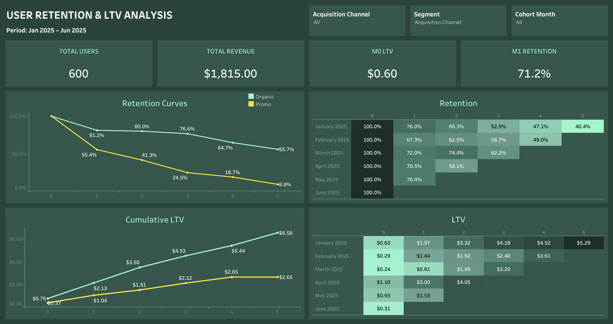
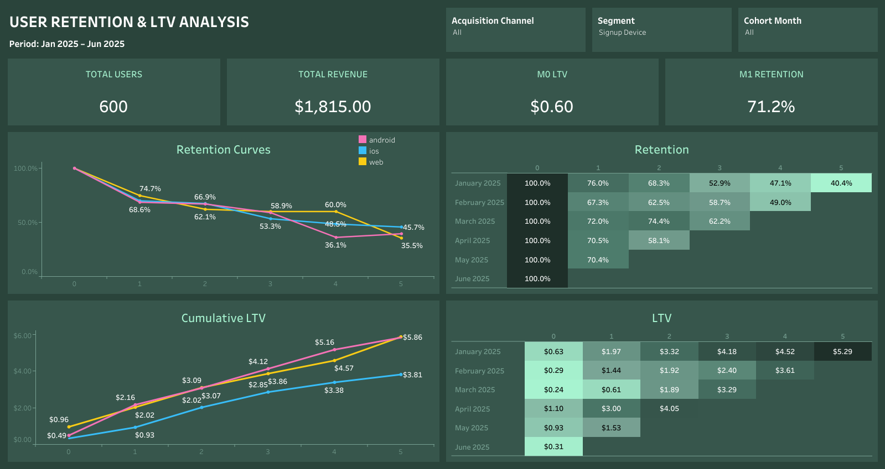
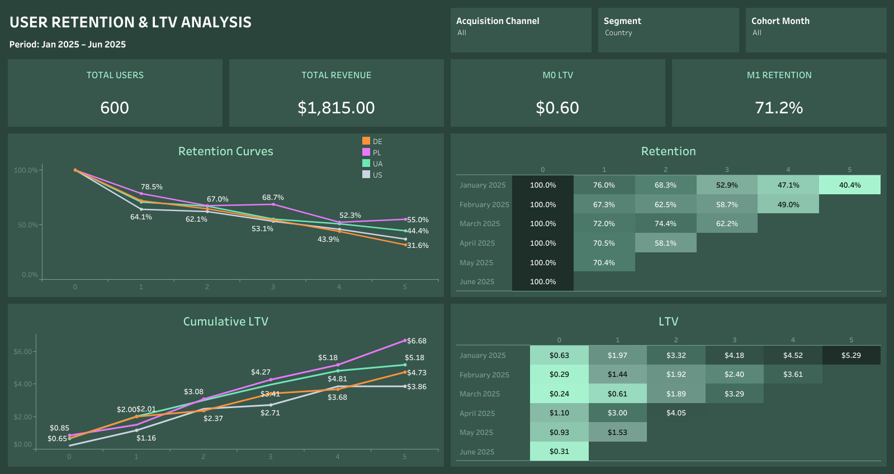
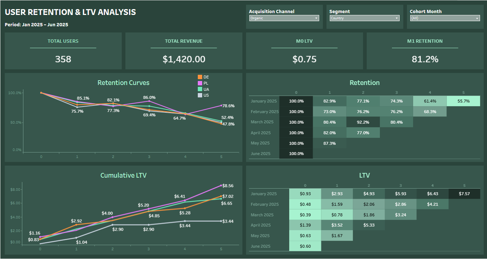

# User Retention Rate & Cohort Analysis

**SQL · Google Sheets · Tableau Public · DBeaver · PostgreSQL**

🔗 **[Interactive dashboard on Tableau Public](https://public.tableau.com/app/profile/hanna.khomenko/viz/UserRetentionLTVAnalysis/UserRetentionLTVAnalysis)** · [Google Sheets model](https://docs.google.com/spreadsheets/d/1YE_AwK6lvfs4sGcmUpeZucy5gmYDZcSgJPxOoxCoc64/edit?usp=sharing)

Evaluating user retention with cohort analysis. The project has two stages:
1. **Retention analysis** in SQL and Google Sheets: monthly cohorts, promo vs. organic users.
2. **Extension in Tableau**: an interactive dashboard that adds LTV (cumulative revenue per user) and segments by acquisition channel, device and country.

---

## 🎯 Goal

Show how user retention changes over the first months of a user's life in the product, and answer a practical business question: **which acquisition channels bring users who stay and pay?**

Key questions:
- How does Retention Rate change across monthly signup cohorts?
- How do **promo users** (acquired through promotions and ads) behave compared with **organic users**?
- What does this say about acquisition quality?
- Do promo users pay back? How does their cumulative revenue per user (LTV) compare with organic users?
- Do retention and LTV differ by device or country?

---

## 🗂 Data

The project uses two raw tables from a training dataset (course project).

**`cohort_users_raw`**: basic user information

| Field | Description |
|---|---|
| `user_id` | Unique user identifier |
| `full_name` | User name |
| `email` | Email (noisy: extra spaces, mixed case) |
| `country` | Country |
| `signup_datetime` | Signup date and time as free-form text |
| `signup_source` | Acquisition channel |
| `signup_device` | Device |
| `promo_signup_flag` | `1` = promo signup, `0` = organic |

**`cohort_events_raw`**: user activity after signup

| Field | Description |
|---|---|
| `event_id` | Unique event identifier |
| `user_id` | Related user |
| `event_datetime` | Event date and time as free-form text |
| `event_type` | `login`, `view_content`, `purchase`, `registration`, etc. |
| `revenue` | Transaction amount, if any |

Stage 1 uses the signup date, promo flag and event dates. Stage 2 also uses country, device and signup source from `cohort_users_raw`, and `event_type` and `revenue` from `cohort_events_raw`.

### Data quality issues handled
- Dates stored as text in inconsistent formats: day-month-year order is constant, but separators (`.` `/` `-`), 2- vs 4-digit years and 1- vs 2-digit days and months vary
- Noisy emails (whitespace, letter case)
- Test events, NULL values and empty event types
- Events outside the observation window (Jan–Jun 2025)

---

## 🔧 Approach

### Stage 1. Retention analysis: SQL and Google Sheets

**Part 1: Data preparation in SQL (DBeaver, PostgreSQL)**
- Parsed and standardized dates from multiple text formats into one date format (regular expressions)
- Cleaned the data: removed test events, NULLs and empty event types, filtered out events outside the observation window
- Joined the users and events tables
- Assigned each user to a **signup-month cohort**
- Calculated the **month offset** (months since signup) for every event
- Aggregated active users by cohort, month offset and promo status

Query: [`sql/Cohort_analysis_FP_1_Khomenko_final.sql`](sql/Cohort_analysis_FP_1_Khomenko_final.sql)

**Part 2: Cohort tables in Google Sheets**
- Built interactive cohort tables with pivot tables and conditional aggregation
- Calculated Retention Rate as the share of a cohort still active in each month
- Used a mix of absolute and relative references in formulas
- Applied conditional formatting (heatmap) to make retention patterns easy to read
- Compared promo vs. organic users side by side

### Stage 2. Extension: retention and LTV dashboard in Tableau
- Wrote an extended SQL query that returns user-level data with signup type, source, device, country, event type and revenue ([`sql/Retention_LTV_Cohort_Analysis_ext.sql`](sql/Retention_LTV_Cohort_Analysis_ext.sql)), and exported it to Tableau
- Calculated cohort month, month offset, Retention Rate and cumulative LTV per user
- Built retention curves, cumulative LTV curves and two cohort heatmaps (retention and LTV)
- Added controls: an **Acquisition Channel** filter (All / Organic / Promo) and a **Cohort Month** filter for the whole dashboard, and a **Segment** parameter that switches the line charts between acquisition channel, device and country
- Added KPI cards: total users, total revenue, M0 LTV, M1 retention

---

## 📈 Results

### Stage 1. Retention: promo vs. organic
- **Organic cohorts keep over half of their users in month 5, while promo cohorts fall below 10%.**
- Organic brought more users at the start: **358 vs. 242** in month 0.
- Promo cohorts lose the most users in month 1: retention is **47–62%** vs. **73–87%** for organic.

**Deliverable:** a dynamic Google Sheets cohort model that analyzes retention and helps predict user behavior.

### Stage 2. New insights from the Tableau dashboard
Period: January – June 2025 signup cohorts, 600 users, $1,815 total revenue.

- **Retention curves.** On average, 81.2% of organic users are active in month 1 vs. 55.4% of promo users. By month 5 the gap is 55.7% vs. 8.8%.
- **LTV.** By month 5, an organic user has generated **$6.58** in cumulative revenue vs. **$2.65** for a promo user (about 40%). The promo curve stops growing after month 4.
- **Revenue share.** Promo users are 40% of all users (242 of 600) but bring only 22% of revenue ($395 of $1,815). Organic users bring $1,420.
- **Device.** iOS users have the highest month-5 retention (45.7%) but the lowest cumulative LTV ($3.81), against about $5.86 for Android and web.
- **Country.** Poland leads on both retention (55.0% in month 5) and LTV ($6.68). Germany has the lowest retention (31.6%), and the US has the lowest LTV ($3.86). The gap is even clearer among organic users only: Poland reaches $8.56 LTV and 78.6% retention in month 5, while the US stays at $3.44 and its LTV barely grows after month 2.
- **Note.** The segments contain few users, so differences by device and country are hypotheses to test rather than firm conclusions.

### Recommendations
1. Judge promo campaigns by longer-term activity and **LTV**, not by launch traffic or signups.
2. Audit promo traffic sources: promo users lose more than 40% of the cohort already in month 1.
3. Improve early retention: focus onboarding and re-engagement on the first 30 days, where promo retention drops the most.
4. Shift budget toward organic channels with better retention, such as referrals.
5. Look into monetization on iOS: users stay but bring the least revenue.

---

## 🖼 Screenshots

**Google Sheets: cohort tables**<br>


**Tableau dashboard: promo vs. organic**<br>


**By device**<br>


**By country**<br>


**Organic users by country**<br>


---

## 🛠 Skills

| Area | Skills |
|---|---|
| **SQL** | Table joins, CTEs, filtering, date parsing with regular expressions, cohort and month-offset calculation |
| **Google Sheets** | Pivot tables, conditional aggregation, advanced formulas, conditional formatting |
| **Tableau** | Calculated fields, parameters, filters, cohort heatmaps, retention curves, cumulative LTV, KPI cards |
| **DBeaver** | Database work and query development |
| **Analytics** | Cohort analysis, Retention Rate, LTV, acquisition quality assessment |

---

## 📁 Repository structure

```
cohort-retention-analysis/
├── README.md
├── sql/
│   ├── Cohort_analysis_FP_1_Khomenko_final.sql
│   └── Retention_LTV_Cohort_Analysis_ext.sql
└── images/
    ├── cohort-all.png
    ├── cohort-organic.png
    ├── cohort-promo.png
    ├── tableau-overview.png
    ├── tableau-device.png
    ├── tableau-country.png
    └── tableau-organic-country.png
```
